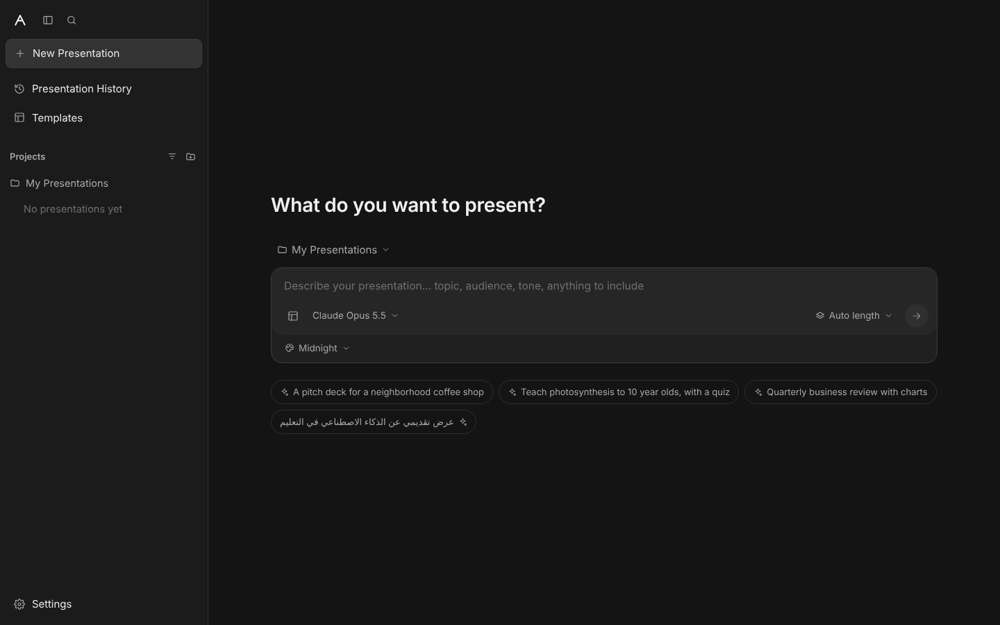
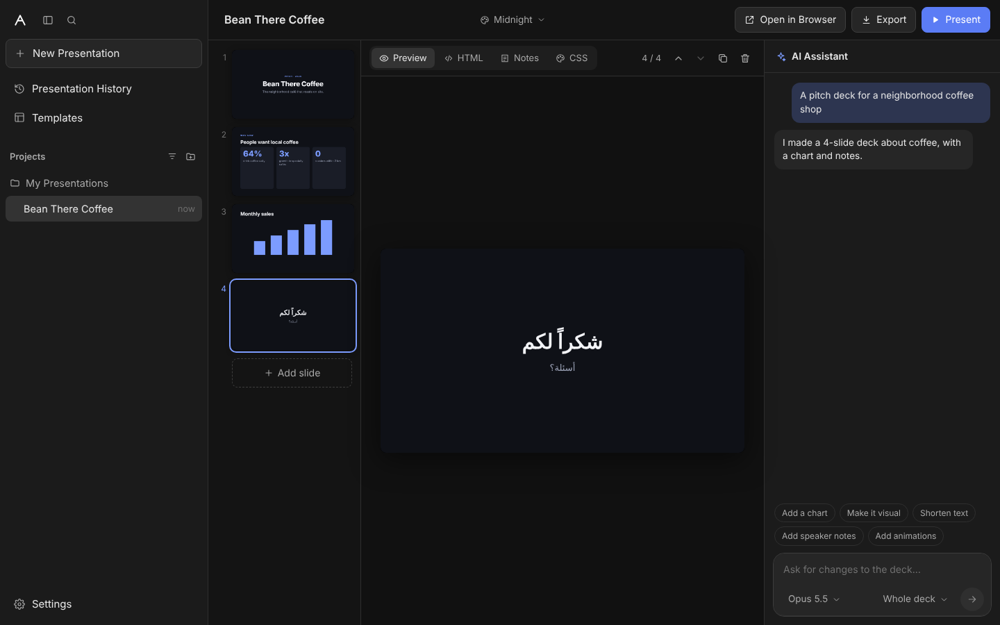

# Lawnak Vision

A desktop app for building slide decks with AI, the way Claude Code builds software, but for presentations.
Describe what you want to present, and Claude designs the slides live as HTML, CSS and JavaScript.
Then edit them by hand or by chatting, present them full screen, or open them in any web browser.

Built with **Electron + TypeScript + React**.





## Features

- **AI slide generation**: type a prompt ("a pitch deck for a coffee shop", "teach photosynthesis with a quiz") and watch slides appear one by one.
- **Chat to edit**: ask for changes to the whole deck or to one slide ("make slide 3 a timeline", "translate to Arabic").
- **Slides are HTML + JavaScript**: every slide is a 1280×720 HTML canvas. Slides can run scripts for quizzes, counters or live charts.
- **Edit by hand**: HTML, speaker notes and deck CSS tabs with a live preview.
- **Present in the app**: full-screen presenter with arrow keys, click, touch swipe and speaker notes (`N`).
- **Open in browser**: the deck becomes one self-contained `.html` file that works in any browser, offline.
- **Export**: HTML file or PDF (one slide per page).
- **Projects, history, templates and themes**: organise decks in a sidebar like the one in Claude Code / Antigravity.
- **Right-to-left support**: Arabic and other RTL languages render correctly.

## Getting started

Requirements: Node.js 20 or newer.

```bash
npm install
npm run dev        # start the app with hot reload
```

Then open **Settings** in the app and paste your Anthropic API key (get one at https://console.anthropic.com).
The key is encrypted with your system keychain. You can also set `ANTHROPIC_API_KEY` in the environment instead.

Without a key you can still use the **Templates** and edit slides by hand.

> **Using WSL?** Electron needs a display. On Windows 11, WSLg usually works out of the box. If the window does not appear,
> clone the repo on the Windows side and run `npm install` and `npm run dev` from PowerShell.

### Other commands

```bash
npm run build      # type check and build into out/
npm start          # run the built app
npm test           # unit tests
npm run dist       # package an installer into release/ (Windows .exe, macOS .dmg, Linux AppImage)
```

## Keyboard shortcuts

| Where | Keys | Action |
|---|---|---|
| App | `Ctrl+N` | New presentation |
| App | `F5` | Present from the selected slide |
| App | `Ctrl+B` | Open in browser |
| App | `Ctrl+E` / `Ctrl+P` | Export HTML / PDF |
| App | `Ctrl+\` | Toggle sidebar |
| App | `Enter` / `Shift+Enter` | Send prompt / new line |
| Presenting | `→` `Space` `PageDown` / `←` `PageUp` | Next / previous slide |
| Presenting | `F` | Full screen (browser) |
| Presenting | `N` | Show speaker notes |
| Presenting | `Esc` | Leave the presentation |

## How slides work

A deck is a list of slides. Each slide is the inner HTML of a `<section class="slide">` that is always 1280×720 and is
scaled to fit the screen. Themes set CSS variables (`--bg`, `--fg`, `--accent`, `--surface`, …), and a few helper classes
make good layouts easy:

| Class | Use |
|---|---|
| `center` (on the slide) | Center everything, for title and section slides |
| `rtl` (on the slide) | Right-to-left text |
| `kicker`, `lead` | Small label above a heading, large subtitle |
| `grid-2`, `grid-3`, `card` | Columns and panels |
| `stat`, `badge` | Big numbers, pill labels |
| `fade-up` | Entrance animation when the slide is shown |

Slide scripts get a `slideenter` / `slideleave` event on their `<section>` and the `active` class while shown.

The AI replies in a simple tag format (`<deck-title>`, `<deck-css>`, `<slide>`, `<notes>`) so the app can show each slide
the moment it is finished.

## Project layout

```
src/
  main/        Electron main process: windows, menus, saving decks, AI calls, present and export
    ai.ts        Claude API call (streaming) and the slide-designer prompt
    store.ts     Decks and settings saved as JSON in the user data folder
  preload/     Safe bridge between the window and the main process (window.api)
  shared/      Code used on both sides
    deckHtml.ts  Builds the standalone presentation HTML and the presenter runtime
    parseSlides.ts  Reads slides out of the AI reply while it streams
    themes.ts    Base slide CSS and the themes
    templates.ts Starter decks
  renderer/    React UI (sidebar, prompt box, editor, chat panel, settings)
tests/         Unit tests (vitest)
```

Decks are stored in your user data folder (for example `%APPDATA%/Lawnak Vision/decks` on Windows,
`~/.config/Lawnak Vision/decks` on Linux).

## AI model

The app uses Claude Opus 5.5 by default; Sonnet 5.5 and Haiku 5.5 can be picked in the prompt box or in Settings.
Requests stream so long decks don't time out, and use prompt caching for the system prompt. For Opus and Sonnet, the
API's server-side fallback is turned on, so a request a model declines is retried on another model automatically.
